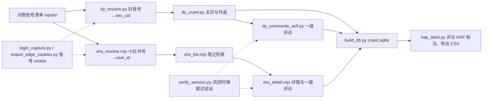

# Crawlers：健康传播账号的抖音、小红书作品与评论抓取，评论 KAP 标注

研究对象是问卷中医疗机构和医生个人填报的抖音号、小红书号。抓取范围是 2025-07-01 至 2026-06-30 发布的作品（笔记）及其一级评论，所有接口原始响应都按 gzip JSONL 保存。整理好的数据写进一个 SQLite，再用 Claude Sonnet 5.5 给每条评论打 KAP 分：

- **K（知识）：** 0–5 分；
- **A（态度）：** 正 / 中 / 负；
- **P（实践）：** 0–5 分。

本期结果：

| | 抖音 | 小红书 |
|---|---|---|
| 问卷账号（去重） | 249，找到 247 | 189，找到 184 |
| 时间范围内的作品 / 笔记 | 15,764 | 10,261 |
| 一级评论（按评论 ID 去重） | 520,991 | 63,535 |
| 评论 KAP 标注 | 全部完成 | 全部完成 |

原始数据和问卷不在仓库里。评论含用户昵称、ID、IP 属地，问卷含医生姓名，都属于个人信息。

## 流程总览



## 目录

| 路径 | 作用 |
|---|---|
| `scripts/login_capture.py` | 用 Playwright 打开 Edge，扫码登录小红书或抖音，把每个号的 cookie 存进 `.secrets/accounts/` |
| `scripts/export_edge_cookies.py` | 从本机 Edge 导出抖音、小红书 cookie（macOS 钥匙串解密） |
| `scripts/verify_session.py` | 账号被风控时弹 macOS 通知，开一个带该账号 cookie 的 Edge 窗口让人过验证码，过完把新 cookie 写回 |
| `scripts/tkd_call.py`、`scripts/dy_profile.py` | 调用本机 TikTokDownloader Web API，取抖音主页数据 |
| `scripts/dy_resolve.py` | 把抖音号换成 sec_uid（搜索）；`--names` 改按问卷里的账号名称搜 |
| `scripts/dy_crawl.py` | 抓抖音主页和时间范围内的全部作品 |
| `scripts/dy_comments_self.py`、`scripts/dy_rows.py` | 抓抖音一级评论，每条作品最多 500 条，多个号轮流 |
| `scripts/xhs_resolve.mjs` | 把小红书号换成 user_id |
| `scripts/xhs_list.mjs` | 抓小红书主页和 `--since` 之后的笔记列表 |
| `scripts/xhs_detail.mjs` | 逐篇打开小红书笔记页取详情，再翻一级评论（每篇最多 `--max-comments` 条），多个号轮流 |
| `scripts/env.sh` | 服务器上补 PATH，并导出 redbook 需要的 cookie 环境变量 |
| `scripts/build_db.py` | 把抓取结果和问卷对应关系建成 `outputs/crawl.sqlite` |
| `scripts/kap_label.py`、`run_kap.sh` | 评论 KAP 批量标注（Claude Agent SDK，走 Claude 订阅），结果写回 SQLite 并导出 CSV |
| `prompts/kap_codebook.md` | KAP 编码手册，也就是标注用的系统提示词 |

## 环境

| 依赖 | 用在哪 | 安装 |
|---|---|---|
| Python 3.10+ | 全部 Python 脚本 | `uv venv && source .venv/bin/activate && uv pip install -r requirements.txt` |
| Microsoft Edge | 扫码登录、过验证码（Playwright 用 `channel="msedge"` 调本机 Edge） | 本机已装即可 |
| Node.js 22 + redbook 0.8.2 | 小红书脚本 | `npm i -g @lucasygu/redbook@0.8.2` |
| [TikTokDownloader](https://github.com/JoeanAmier/TikTokDownloader) V5.8 | 抖音搜索、主页、作品、评论 | 单独建它自己的 venv；`Volume/settings.json` 里设 `"run_command": "7"` 起 Web API，`src/custom/static.py` 里把 `SERVER_HOST` 改成 `127.0.0.1`；用环境变量 `TKD_REPO` 指向仓库目录 |
| Claude Code 订阅 | KAP 标注 | 本机登录 Claude Code 即可；`kap_label.py` 会清掉 `ANTHROPIC_API_KEY`，固定走订阅额度 |

`dy_crawl.py`、`dy_resolve.py`、`dy_profile.py` 要在 TikTokDownloader 的 venv 里运行，因为它们直接导入 TikTokDownloader 的模块。

## 输入（不在仓库里）

| 文件 | 格式 |
|---|---|
| `inputs/douyin_ids.txt`、`inputs/xhs_ids.txt` | 问卷里的抖音号、小红书号，一行一个 |
| `inputs/douyin_meta.json`、`inputs/xhs_meta.json` | `{账号: {"type": "机构"或"个人", "name": 问卷里的名称, "responses": [答卷编号], "self_reported_fans": 自报粉丝数}}` |
| `.secrets/accounts/*.json`、`.secrets/douyin_cookies.json` | `login_capture.py` / `export_edge_cookies.py` 的输出，权限 600 |

## 流程

### 1. 准备账号

```bash
python scripts/login_capture.py xhs --max 3        # 逐个扫码，每个号一份 cookie
python scripts/login_capture.py douyin --max 3
python scripts/export_edge_cookies.py --out .secrets   # 或直接用本机 Edge 里已登录的号
```

### 2. 抖音

搜索在机房 IP 上会被要求过滑块，所以 `dy_resolve.py` 在家庭网络上跑。作品列表和评论可以放在服务器上跑，也可以在本机跑。

```bash
# 抖音号 → sec_uid；搜不到的再按问卷名称搜
TKD_REPO=... DY_COOKIE_FILE=... python scripts/dy_resolve.py --ids inputs/douyin_ids.txt --out-dir outputs/dy_resolve --gap 120
TKD_REPO=... DY_COOKIE_FILE=... python scripts/dy_resolve.py --ids unresolved.txt --names inputs/douyin_meta.json --out-dir outputs/dy_fix/names

# 主页 + 时间范围内的全部作品
DY_COOKIE_FILE=... python scripts/dy_crawl.py --ids inputs/douyin_ids.txt --resolved outputs/dy_resolve/resolved.jsonl \
  --out-dir outputs/dy_full --since 2025/07/01 --until 2026/06/30 --gap 60

# 一级评论（需要先起 TikTokDownloader Web API），多个号轮流
DY_COOKIE_FILE=... python scripts/dy_comments_self.py --out-dir outputs/dy_full --accounts .secrets/accounts/douyin_*.json --max-comments 500
```

抖音评论接口没有排序参数，只能按默认热度排序翻页。用全量数据核对过：一级评论超过 500 条的 73 条作品，默认排序的前 500 条都包含点赞最多的 100 条。导出时再按点赞数排序。

### 3. 小红书

```bash
source scripts/env.sh          # 用 XHS_ACCOUNT_FILE 指定用哪个号的 cookie
RAW_FILE=outputs/xhs_full/raw/search_user.jsonl.gz node scripts/xhs_resolve.mjs $(cat inputs/xhs_ids.txt) > outputs/xhs_full/resolved.jsonl
node scripts/xhs_list.mjs --accounts outputs/xhs_full/resolved.jsonl --out-dir outputs/xhs_full --since 2025-07-01 --raw-dir outputs/xhs_full/raw
node scripts/xhs_detail.mjs --list outputs/xhs_full/notes_list.jsonl --out-dir outputs/xhs_full \
  --from 2025-07-01 --to 2026-06-30 --max-comments 100 --gap 15
```

`xhs_detail.mjs` 必须在家庭网络上跑。它会轮流使用 `.secrets/accounts/` 里的所有小红书号，每两篇之间间隔 `--gap` 到 `2×gap` 秒。

### 4. 风控时人工过验证

`xhs_detail.mjs`、`dy_comments_self.py`、`dy_resolve.py` 检测到验证码或登录失效时，会调用 `verify_session.py`：弹出 macOS 通知，同时打开一个带该账号 cookie 的 Edge 窗口。过完验证码直接关掉窗口，新 cookie 会写回账号文件，抓取接着跑；还被拦就再弹一次。

小红书跳到「账号异常，请稍后再试」（`error_code=300011`）时没有验证码可过，这个号会停用 3 小时，不弹窗。

### 5. 建库

```bash
python scripts/build_db.py      # 约 11 秒，整库重建
```

| 表 | 内容 |
|---|---|
| `accounts` | 问卷里的每个账号：问卷类型、名称、自报粉丝数，是否找到、怎么找到的（按号、按名称或按抖音短号），主页粉丝数 |
| `account_responses` | 账号对应的答卷编号 |
| `posts` | 时间范围内的作品 / 笔记：正文、话题、互动数；抖音另有 AI 标识（`ai_label`、`ai_download_forbidden`） |
| `comments` | 一级评论：文本、时间、点赞、回复数、评论者 |
| `kap_labels` | KAP 标注结果，按编码手册哈希区分版本（由 `kap_label.py` 写入） |

时间都存成北京时间 `YYYY-MM-DD HH:MM:SS`。

### 6. 评论 KAP 标注

```bash
./run_kap.sh --workers 8          # 一键：标注（断点续跑）→ 导出 outputs/export/*.csv
./run_kap.sh --limit-batches 2    # 先跑 2 个请求试一下
```

| 机制 | 做法 |
|---|---|
| 打包 | 同一作品的评论放在一起，附作品标题作上下文；每个请求 1500 条（`--batch-size`） |
| 去重 | 同一作品下文本相同的评论只标一次；空文本按规则记 K0 / 中 / P0 |
| 并行 | `--workers` 个请求同时跑 |
| 额度 | 订阅额度用完时，全部请求暂停：报错里有重置时间就等到那时，没有就每 30 分钟试一次，恢复后自动接着跑 |
| 断点续跑 | 每个请求一完成就写库；中断后重跑同一条命令即可，漏标的自动补跑最多 2 轮 |
| 导出 | `accounts.csv`、`posts.csv`、`comments_kap.csv`、`accounts_kap.csv`，带 BOM，可以直接用 Excel 打开 |

单次请求的上限是输出 token，不是上下文窗口：每条评论约 21 个输出 token。1500 条一个请求实测漏标 0 条，耗时约 260 秒，输入约 10 万、输出约 3.2 万 token。本期 58.5 万条评论开 8 路并行，中间等了一次订阅额度重置，共 8 小时标完。

编码手册的选法：先由 Opus 5.5 从三个角度各写一版候选，分别是已发表的理论框架、本数据的评论类型、标注一致性优先。每版由两个 Sonnet 5.5 编码员在同一份 180 条分层样本上独立标注，算两人之间的一致性；选出最佳的一版作为底，补上分歧暴露出的规则缺口，最后再双编码验证一次。

| 手册 | K 加权 kappa | P 加权 kappa | A kappa |
|---|---|---|---|
| 理论锚定（Nutbeam 2000 健康素养、SOLO 分类、跨理论模型） | 0.897 | 0.916 | 0.811 |
| 数据驱动 | 0.930 | 0.874 | 0.827 |
| 一致性优先 | 0.972 | 0.959 | 0.940 |
| **最终版**（以一致性优先为底改写） | **0.947** | **0.920** | **0.931** |

这些都是两个模型编码员之间的一致性。写进论文时，建议另做一次人工标注和模型标注的一致性检验。

## 实测的风控规律（2026-10）

| 现象 | 原因与对策 |
|---|---|
| 小红书在服务器上跑 20 分钟，两个号 48 秒内先后被拦 | 跟机房 IP 有关，改在家庭网络上跑 |
| 小红书每个号连续打开约 160 篇笔记后跳验证码 | 跟单号请求量有关，放慢没用；用多个号分摊，弹窗过验证码 |
| 小红书号被判「账号异常」（300011） | 重新登录也解不开，只能等或换号 |
| 抖音搜索 20 多分钟搜约 20 次后返回 `verify_check` | 服务器 IP 上一直不恢复，家庭网络上过几小时会自己恢复；搜索放在本机慢慢跑 |
| 抖音评论接口连续用约 20 小时后返回空响应（`bd-ticket-guard-result: 1101`） | 这是登录状态被标记，换 IP 没用；在浏览器里打开视频评论区过一下验证，再导出新 cookie 就恢复 |
| 问卷里的纯数字抖音号搜不到 | 这些是抖音老的数字短号，搜索结果里没有，要按短号直接查主页 |
| TikTokDownloader 翻评论在看不到评论的作品上耗时 15–25 分钟 | 抖音对这类作品一直返回「还有下一页」；按页面显示的评论数给翻页数封顶 |

## 说明

本期有一部分笔记详情、评论和账号补查用了付费的第三方接口，那部分代码不在仓库里。`build_db.py` 仍会读取那部分的输出文件，例如 `comments_tikhub.jsonl`、`accounts_tikhub.jsonl`、`tikhub_resolved.jsonl`；这些文件不存在时，对应部分为空。
